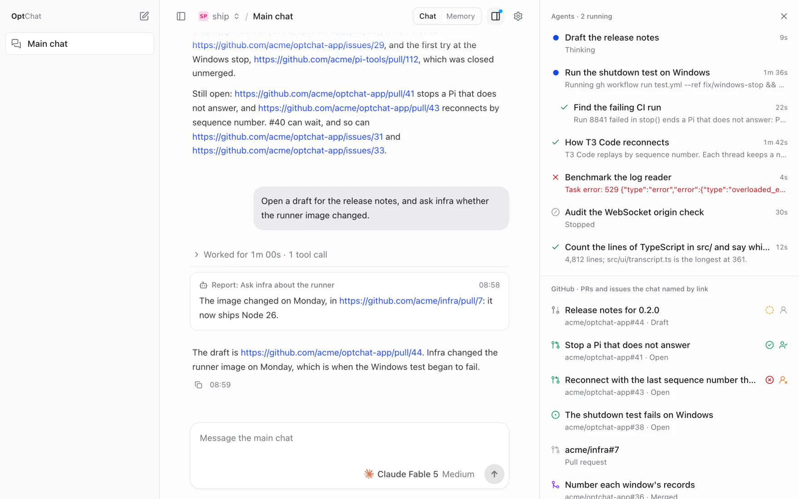
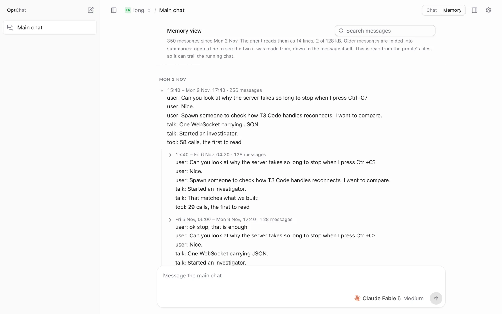
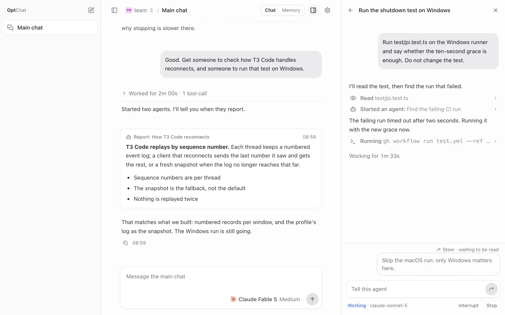
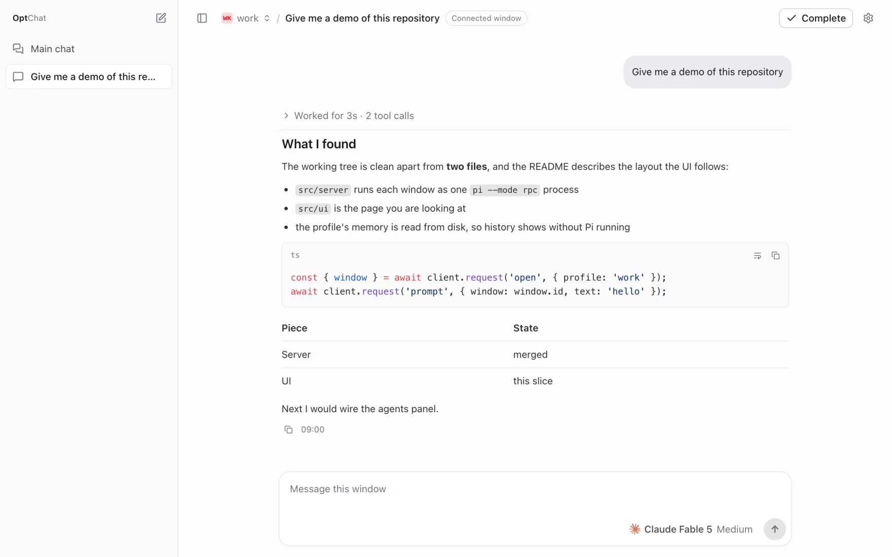

<p align="center">
  
</p>

<h1 align="center">OptChat</h1>

<p align="center">One chat that never ends, with a memory you can see.</p>

<p align="center">
  <a href="https://github.com/jonaslsaa/optchat-app/releases/latest"><b>Download</b></a>
  &nbsp;·&nbsp; macOS, Apple Silicon
</p>

<p align="center">
  <picture>
    <source media="(prefers-color-scheme: dark)" srcset="docs/images/chat-dark.webp">
    
  </picture>
</p>

Coding agents forget. A thread fills up, gets compacted, and you explain the project again in the next one.

OptChat is one chat per profile that never ends. Every message is kept, and the agent reads all of it as a tree of summaries: the latest messages word for word, older ones folded smaller. You can open that tree yourself, down to the original message.

Work in parallel stays in sight. Open a second window on the same chat, or let the agent start subagents, then watch, steer or stop any of them.

It is the desktop app for [pi-optchat](https://github.com/jonaslsaa/pi-optchat), built on [Pi](https://pi.dev). A profile is the same one in the app and in your terminal.

## A memory you can open

The Memory view shows what the agent reads this turn. Open any summary into the two it was made from, all the way down to the messages as they were said. Search finds any message and shows where it sits in the tree.

<p align="center">
  <picture>
    <source media="(prefers-color-scheme: dark)" srcset="docs/images/memory-dark.webp">
    
  </picture>
</p>

## Agents you can steer

Every subagent is listed live with what it is doing right now, and so are the agents it started. Open one to read its chat, tell it something, interrupt it, stop it, or start a finished one again. When the app restarts on agents that were cut off, one bar offers to resume them, a line a profile; it never spends tokens on its own.

<p align="center">
  <picture>
    <source media="(prefers-color-scheme: dark)" srcset="docs/images/agent-dark.webp">
    
  </picture>
</p>

## Windows that hand work back

Open a connected window for a side task. It reads the same memory, and **Complete** hands what it did back to the main chat.

<p align="center">
  <picture>
    <source media="(prefers-color-scheme: dark)" srcset="docs/images/window-dark.webp">
    
  </picture>
</p>

## And the rest

- **Profiles.** `work` and `personal` keep separate memories and instructions. Each has a coloured badge, so you always know which one you are in.
- **GitHub.** The pull requests and issues the chat mentioned, with their live status, checks and reviews.
- **Models.** One button picks the model and how hard it thinks, for the chat and for its subagents.
- **Bring your history.** Import what Claude Code, Codex, Pi and ChatGPT already know into a profile's memory: pick the projects or single conversations, see what it will cost before you start, and pause it any time. A new profile asks right away whether you want to bring yours.
- **Usage and limits.** Cost, tokens and cache share, by role and model, over time. Bars show how much of your provider's limit is left, and a clear notice says when you hit one.
- **A composer that keeps up.** Type at any time: Enter steers a running agent, ⌘Enter queues for after it, and ⌥↑ takes back what it has not read yet to edit. Paste or drop images, `/` for commands and skills (a skill you run shows as its name, not its whole file), ↑ for earlier messages, ⌘F to find in the chat, and cite any selection, or a line of the memory, in your reply. Drafts survive a restart.
- **Nothing hidden.** While the agent thinks, one click shows what it is thinking. A tool call reads as what it did and opens to what it printed and the pictures it returned (a screenshot the agent read, large on a click), and a file the agent changed opens as the diff, with the lines put in and taken out counted beside its name. Code is highlighted, formulas are typeset, a picture the agent saved (a screenshot, a chart) shows in its reply, a picture opens large to zoom into and step through the rest of its message's, a table copies as Markdown or CSV, a file a reply names opens in your editor, every reply has a copy button, and notices from Pi show in the chat.
- **A proper Mac app.** It follows light and dark, keeps the Mac awake while agents work, remembers where its window was, and asks before it quits on running agents.
- **Setup in the app.** It installs Pi and pi-optchat, signs you in, and keeps every setting on one page. Once a newer pi-optchat is installed, the app moves its chats onto it as soon as they have nothing running, and asks first when they do.

## Install

1. [Download the dmg](https://github.com/jonaslsaa/optchat-app/releases/latest), open it, and drag OptChat to Applications.
2. Open it. The app is not signed with an Apple Developer ID, so macOS stops the first open: press **Done**, then System Settings → Privacy & Security → **Open Anyway**.

Downloaded with the GitHub CLI instead, it opens like any other app:

```sh
gh release download --repo jonaslsaa/optchat-app --pattern '*.dmg' --dir ~/Downloads
```

The first run sets up the rest: Pi, pi-optchat and your model login. It needs Node.js 22.19 or newer. After that OptChat keeps itself up to date: a new version downloads in the background, and it asks before it restarts.

## Under the hood

Built on [Pi](https://pi.dev) and [pi-optchat](https://github.com/jonaslsaa/pi-optchat), which implements [Victor Taelin's OptChat recipe](https://gist.github.com/VictorTaelin/91837951a5ce5b38f341ec1ba1df6449). Parts of the UI come from [T3 Code](https://github.com/pingdotgg/t3code).

For the internals, start at [docs/design.md](docs/design.md). To run it from a checkout: `npm install && npm run desktop`.


[MIT](LICENSE) & [THIRD_PARTY_NOTICES.md](THIRD_PARTY_NOTICES.md)
